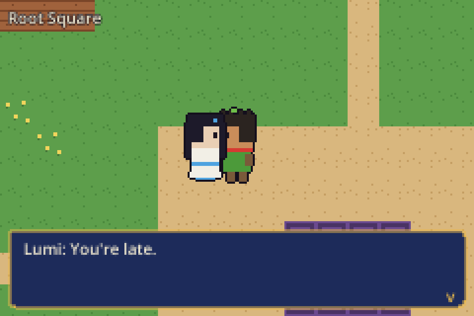

# Two Worlds

A whimsical GBA-style pixel RPG set in 1963 Malaysia, built in **Godot 4**.
Spirit kids Reno and Lumi sneak out of Kampung Akar to see a human train.
The first target is the 20 to 30 minute prologue, *The Great Escape*.

All art in this build is **generated placeholder art**. The handover images are mood boards, not sprites.



## Run it

1. Install [Godot 4.4 or newer](https://godotengine.org/download) (the standard build, not .NET).
2. In the Godot Project Manager, click **Import**, pick this folder's `project.godot`, then **Import & Edit**.
3. Press **F5** (or the ▶ Play button at the top right).

### Controls

| Action | Keyboard | Gamepad | Touch |
|---|---|---|---|
| Move | Arrows or WASD | D-pad or left stick | On-screen D-pad |
| Confirm / talk | Z, Enter, Space | A | A |
| Cancel | X, Backspace | B | B |
| Menu (Journal, Items, Party) | Esc or M | Start | M |
| Swap Reno and Lumi | C or Tab | Y | S |
| Show the touch pad on desktop | F2 | | |

The touch pad shows itself on touch screens. On desktop, press F2 and click its buttons with the mouse.

### What to try

1. **New Game** starts in Reno's Home (KA-02) with the dream and wake-up scene (P00). Reno gets his railway token.
2. Leave through the door at the bottom into Root Square (KA-01).
3. Lumi waits by the plaza. Face her and press Z: scene P01 plays, with a three-way flavour choice, and she joins.
4. Walk around: Lumi follows on the exact path Reno walked. Press C to swap leaders.
5. Take the north path to Elder's Hollow (KA-05) for Nenek Rimba's warning (P02).
6. Take the east path to Root Market (KA-04). Bobo (P03) starts the parcel errand.
7. Press Esc to open the Journal, Items and Party menu.
8. Take the south path to the Training Glade (KA-06). It opens once you've heard Nenek and spoken to Bobo.
9. Walk into the Leafling for the tutorial battle (P04). Press A as the ring closes: on your attacks for a stronger hit, and on the Leafling's Seed Toss to dodge.
10. Bring the parcel back to Bobo for the lantern and two Dewdrop Candies.

### Battle basics

Each round, everyone acts once, fastest first. Commands are Attack, Skill (costs MP), Guard (halves damage until your next turn and gives 2 MP) and Item. Timed presses within 80 ms of the cue are Perfect (1.5x), within 180 ms Good (1.2x). Dodging an enemy cue Perfectly avoids the hit; Good halves it. Losing restarts the battle from just before it began. HP and MP refill after each prologue battle.

## Run the tests

From this folder, with `godot` meaning your Godot 4.4+ executable:

```
godot --headless --import
godot --headless --script res://tests/run_tests.gd
```

The first command only needs running once after cloning. The tests check every map, spawn and door, the game state save format, input mode ownership, the follow trail, and a scripted walk through both maps. It exits with code 0 when everything passes.

## How it's built

| Piece | Where | What it does |
|---|---|---|
| Pixel-perfect screen | `project.godot` | 240x160 world, scaled up by whole numbers only, nearest-neighbour filtering |
| `GameState` | `autoload/game_state.gd` | The one versioned game state: map, position, party, stats, wallet, items, quests, flags. Validates and migrates saves. |
| `InputManager` | `autoload/input_manager.gd` | Keyboard, gamepad and touch share named actions. One mode owns input at a time and each press is consumed once, so closing a message can't also trigger something behind it. |
| `Assets` | `autoload/assets.gd`, `content/asset_manifest.json` | Asset IDs with status. Missing files get a generated placeholder, so real art drops in by setting `path`. |
| Maps | `content/maps/*.json`, `scripts/exploration/map_data.gd` | Placeholder ASCII maps with spawns, two-way doors, NPCs and signs. Checked at boot and in tests. |
| Exploration | `scripts/exploration/` | Movement with collision, camera clamped to the map, Lumi following safe prior positions, swapping, doors with fades. |
| Dialogue | `content/dialogue/*.json`, `scripts/ui/dialogue_box.gd` | Scenes as lists of steps: lines with name and portrait, up to three choices, and story steps (flags, items, party joins). NPCs pick a scene by story flags. |
| Quests | `content/quests.json`, `autoload/quests.gd` | Quests move locked → active → completed → rewarded when story flags change. Each reward is granted once. |
| Combat | `scripts/battle/combat.gd`, `scripts/battle/battle.gd`, `content/enemies.json`, `content/skills.json` | Rules (turn order, tokens, damage, timing windows) kept separate from the battle screen so they can be tested. |
| Menu | `scripts/ui/pause_menu.gd` | Journal, Items (money shown as 1963 dollars and cents) and Party tabs. |

Content files are marked `PLACEHOLDER` or `WORKING_PROPOSAL`, following the handover's status rules.

## Adding real art later

Put a PNG under `assets/` and set its `path` in `content/asset_manifest.json`:

- Characters: one row of 32x40 frames in the order down, left, right, up, feet near the bottom.
- Tiles: one row of 16x16 tiles in the index order from `content/tiles.json`.

## Roadmap

1. ✅ Foundation: screen, input, game state, asset manifest, boot and title
2. ✅ Exploration (first pass): Root Square and Reno's Home, follow, swap, doors
3. ✅ Dialogue and quests: P00 to P03, journal, items and party menu
4. ✅ Combat and the Leafling tutorial
5. Field abilities and Whispering Roots puzzles
6. Inventory and saving
7. The rest of the prologue
